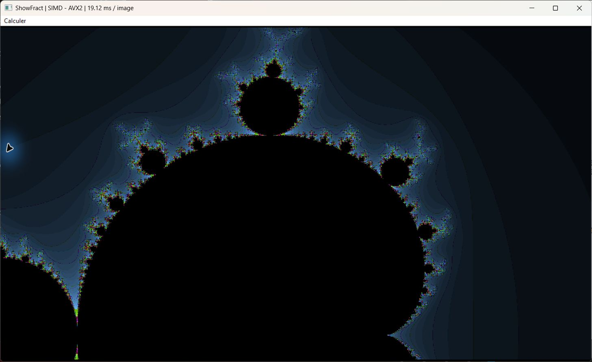

# ShowFract — Calcul parallèle d’une fractale de Mandelbrot

ShowFract calcule une image de Mandelbrot en 1920 × 1080. Le projet consiste à calculer la même zone avec plusieurs méthodes et à mesurer ce que le parallélisme change. Chaque pixel peut être calculé indépendamment, mais le nombre d’itérations varie d’un pixel à l’autre.



*Capture de la version Release x64, en mode SIMD AVX2. La barre de titre affiche la moyenne de dix calculs.*

## Travail réalisé

- Implémenter un calcul séquentiel de référence et comparer plusieurs façons de répartir le travail sur le processeur.
- Comparer le découpage en bandes fixes, l’attribution dynamique des lignes avec un compteur atomique et la répartition automatique avec OpenMP. La répartition dynamique permet aux threads qui terminent tôt de prendre une autre ligne.
- Explorer aussi `parallel_for` de la PPL, les algorithmes parallèles C++17 et les tâches `std::async`.
- Calculer huit pixels à la fois avec des intrinsics AVX et AVX2. Un masque suit les pixels qui continuent d’itérer.

## Mesures

Extrait des relevés historiques de `ClasseurCPU.xlsx`, onglet `Feuil1`, colonne VS15, configuration RelOpt x64.

| Mode | Temps relevé |
| --- | ---: |
| Séquentiel | 1 209 ms |
| Multithread par bandes fixes | 140 ms |
| Multithread avec attribution dynamique des lignes | 60 ms |
| OpenMP | 117 ms |

Le mode dynamique était environ **20 fois plus rapide** que le mode séquentiel dans cette série. Le classeur contient également des relevés Win32, Debug et Release. `Classeur1.xlsx` contient une autre série, organisée par version de Visual Studio. Les classeurs donnent des valeurs ponctuelles, sans série brute par essai ni configuration matérielle documentée.

La nouvelle version a été vérifiée pixel par pixel. Les dix modes ont produit le même résultat que le calcul séquentiel en **1920 × 1080** et en **257 × 127**, une largeur qui sollicite le traitement des derniers pixels hors des blocs de huit. Dans la session de la capture, le mode AVX2 a affiché **19,12 ms par image**.

## Reproduire la démo locale

Sous Windows, avec CMake 3.20 ou ultérieur et Visual Studio 2022 avec les outils C++ de bureau, ouvrir PowerShell à la racine du projet.

```powershell
cmake -S . -B local/build -G "Visual Studio 17 2022" -A x64
cmake --build local/build --config Release
.\local\build\Release\ShowFract.exe
```

Choisir un mode dans le menu **Calculer**. Le mode SIMD requiert un processeur compatible AVX2. Sur les autres machines, la démo démarre en mode multithread dynamique.

Pour comparer automatiquement les images produites par les modes disponibles, lancer le même exécutable avec l’option `--verify`.

```powershell
$test = Start-Process .\local\build\Release\ShowFract.exe -ArgumentList '--verify', 'local/verification.txt' -Wait -PassThru
Get-Content local/verification.txt
$test.ExitCode
```

Le rapport indique `OK` pour chaque image identique à la référence. Le code de sortie est `0` si les comparaisons réussissent.

## Origine des sources

Le projet d’origine a été réalisé dans le cadre d’un cours de parallélisme à Polytech Paris-Saclay. La version actuelle conserve les noyaux de calcul de Mandelbrot et les dix modes expérimentés. Elle utilise une nouvelle fenêtre Win32, un tampon de pixels C++ et un chronomètre standard. Un nouvel itérateur et une file de lignes commune remplacent les extraits `MyIter` et `ThV2SIMD` fournis. Le test intégré remplace l’exemple auxiliaire `TestAVX`.

La configuration de compilation utilise uniquement les fichiers de `src/`. La version MFC d’origine, les classeurs et les exécutables sont archivés dans le dossier local ignoré par Git.
